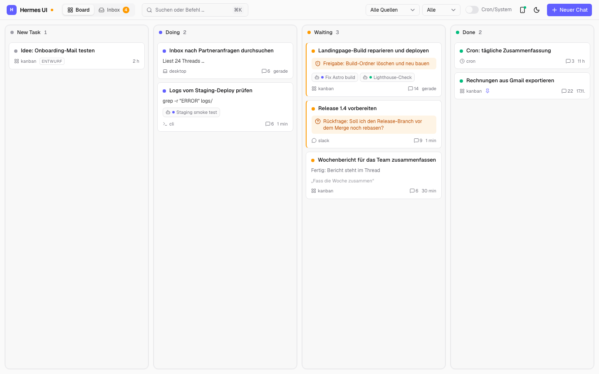
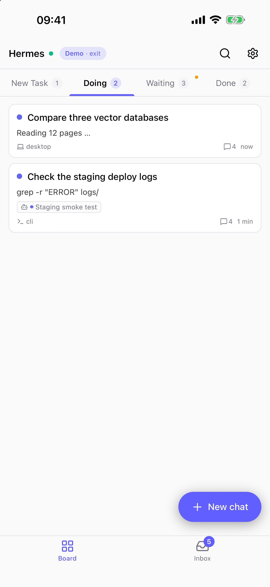
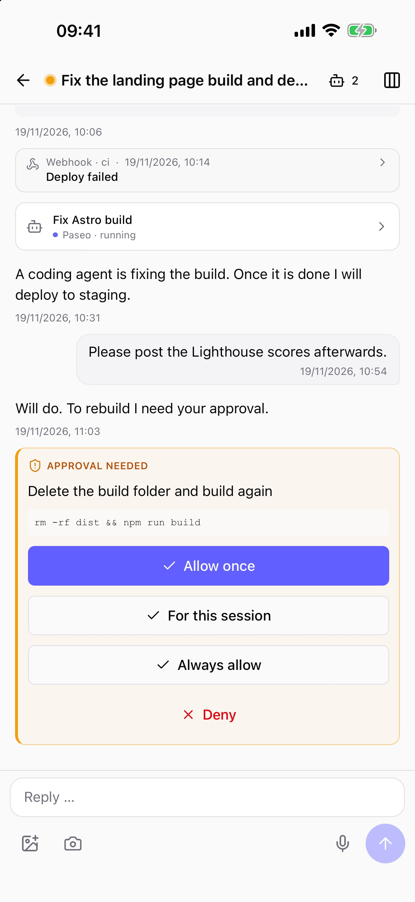
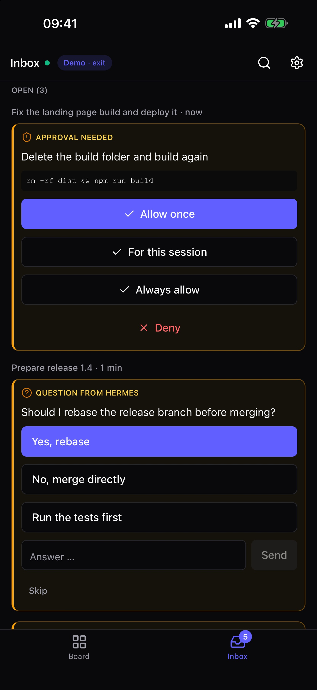

# Hermes UI

A Kanban board for [Hermes Agent](https://hermes-agent.nousresearch.com) sessions: every chat (desktop,
Slack, cron, CLI, or one started from the board) is a card that moves through **New Task → Doing →
Waiting → Done** live. Start and continue chats with text, images and voice, answer approvals and
questions from one inbox (where cron runs, webhook runs and `hermes-ui notify` messages land too), follow the [Paseo](https://paseo.sh) coding agents a chat started, and get
notified when something needs you, in the browser or in the native app for Android and iOS.

Self-hosted: a headless backend runs next to Hermes on your machine (bound to `127.0.0.1`); browsers
and phones reach it end-to-end encrypted over [iroh](https://www.iroh.computer), with no open port and
no account. *Unofficial client, not affiliated with Nous Research.*

| Web (desktop) | App: board | App: thread | App: inbox |
|---|---|---|---|
|  |  |  |  |

All screenshots show made-up demo data.

## Quick start

```bash
git clone https://github.com/MaxGierlachowski/hermes-ui.git && cd hermes-ui
scripts/bootstrap.sh     # Node 24 check, npm ci, iroh-gateway, tests, UI build
npm start                # backend + UI on http://127.0.0.1:8787 (token in .env)
```

Needs Node.js 24 and a running Hermes gateway (the desktop app starts one, or `hermes gateway run`).
For phones: start with `HERMES_UI_REMOTE=iroh`, open the hosted UI
(<https://maxgierlachowski.github.io/hermes-ui/>) or the app, and pair with `npx hermes-ui pair`
(or `node bin/hermes-ui.mjs pair`) → scan the QR code. Details: [docs/self-hosting.md](docs/self-hosting.md).

The **mobile app** ([`app/`](app)) is React Native with a native Rust iroh client. Try it
without a backend: "Try the demo" on its first screen. Builds and pre-releases:
[docs/app.md](docs/app.md), [Releases](https://github.com/MaxGierlachowski/hermes-ui/releases).

The same app also runs in the browser and as a **desktop app for macOS** ([`desktop-app/`](desktop-app),
Tauri 2, with the backend built in): [docs/desktop-app.md](docs/desktop-app.md). A spike, measured
against the web UI in [ADR 0012](docs/decisions/0012-universal-app.md).

## Files in chats

Paths and `file://` links in replies and tool output, and `MEDIA:` attachments of any type, open in an
in-app preview (images, audio, video, PDF, rendered Markdown, highlighted code, CSV tables; a file card
otherwise) with Download and, in the desktop app, Open in default app. It works over iroh like images.
Only files the chat itself mentions, below `HERMES_UI_FILE_ROOTS` (default: your home, hidden
directories excluded), never keys, `.env` files, credentials or app databases:
[security.md › Files in chats](docs/security.md#files-in-chats).

## Documentation

| | |
|---|---|
| [Features](docs/features.md) | board, thread, inbox, search, Paseo, push in detail; [linking agents to chats](docs/features.md#linking-agents-to-chats) (label contract); [automations in the inbox](docs/features.md#automations-in-the-inbox) (cron, webhooks, `hermes-ui notify`) |
| [Self-hosting](docs/self-hosting.md) · [Configuration](docs/configuration.md) | install, remote modes, every setting, autostart |
| [Architecture](docs/architecture.md) · [Decisions](docs/decisions/README.md) | how the pieces fit, and why |
| [Security](docs/security.md) | pairing, allow-list, tokens, what relays see |
| [Development](docs/development.md) | fresh machine in one command, versions, tests |
| [Mobile app](docs/app.md) · [Desktop app](docs/desktop-app.md) · [Releasing](docs/releasing.md) | builds, signing, push, App Store / Google Play, macOS |
| [Secrets and state](docs/secrets-and-state.md) | what is not in git and how to move it |
| [Design](docs/design.md) · [Mobile audit](docs/mobile-audit.md) | visual language, touch standards |

Repository: `server/` backend + CLI · `web/` UI · `app/` the app (phone, web, desktop) · `desktop-app/` Tauri shell · `shared/` shared TypeScript ·
`docs/` · `store/` listing material · `site/` privacy and support pages.

## Contributing and license

See [CONTRIBUTING.md](CONTRIBUTING.md) and [SECURITY.md](SECURITY.md). Hermes UI is released under the
**MIT** license ([LICENSE](LICENSE)); third-party components and their licenses:
[THIRD-PARTY-NOTICES.md](THIRD-PARTY-NOTICES.md).

### Main components


| Component | Use | License |
|---|---|---|
| iroh-fetch, iroh-gateway ([iroh-bridge](https://github.com/irohkit/iroh-bridge)) | Remote access over iroh | MIT |
| @getpaseo/client | Read-only Paseo daemon access (fallback) | Apache-2.0 |
| @modelcontextprotocol/sdk | paseo-mcp client (events) | MIT |
| web-push | Web Push (VAPID, payload encryption) | MPL-2.0 |
| shadcn/ui, Radix UI, Base UI | UI components | MIT |
| Dice UI Kanban, dnd-kit | Board and drag & drop | MIT |
| prompt-kit | Chat input and thread | MIT |
| cmdk, sonner, react-resizable-panels, next-themes | Palette, toasts, panels, theme | MIT |
| react-zoom-pan-pinch | Pinch and double-tap zoom in the image viewer on touch screens | MIT |
| lucide-react | Icons | ISC |
| Tailwind CSS, @tailwindcss/typography, tw-animate-css | Styling | MIT |
| react-markdown, remark-gfm, marked, use-stick-to-bottom | Chat rendering | MIT |
| class-variance-authority | Variants | Apache-2.0 |
| Geist | Font | OFL-1.1 |
| qrcode | Pairing QR codes | MIT |
| cloudflared / Tailscale (external binaries, optional) | Tunnels | Apache-2.0 / BSD-3-Clause |
