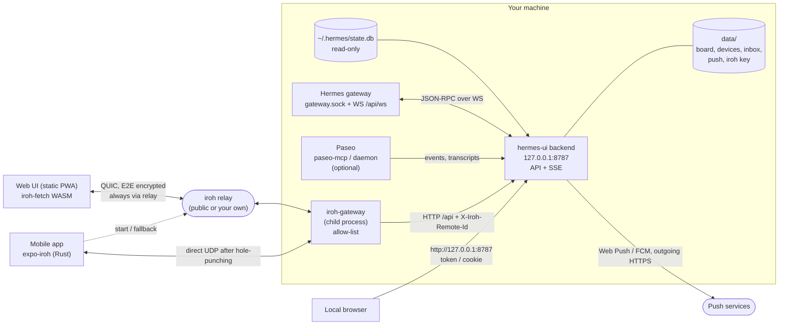

# Architecture

Hermes UI shows every [Hermes Agent](https://hermes-agent.nousresearch.com) session as a card on a
Kanban board. It has three clients and one backend:

- **Backend** (`server/`): a headless Node 24 process on `127.0.0.1:8787`. It reads Hermes, writes
  through the Hermes gateway, and serves an HTTP API plus a live event stream.
- **Web UI** (`web/`): a static React PWA. The backend can serve it, or any static host can.
- **Mobile app** (`mobile-app/`): a React Native (Expo) app with native screens and a native iroh client.

Related documents: [security.md](security.md), [self-hosting.md](self-hosting.md),
[mobile-app.md](mobile-app.md), [development.md](development.md), [design.md](design.md),
[mobile-audit.md](mobile-audit.md) and the [decision records](decisions/README.md).

## Overview

Nothing listens on a public interface. Remote clients reach the backend only through a tunnel that
the backend starts itself (iroh by default; see [self-hosting.md](self-hosting.md#remote-access)).

## Backend and Hermes

The backend never changes Hermes' files or configuration and never restarts the gateway.

**Read path.** `server/src/store.mjs` opens `$HERMES_HOME/state.db` with `node:sqlite` in read-only
mode. A poll every 1.5 s uses a watermark (highest message id, last activity, running admissions and
turn leases) to find changed sessions. Sessions from every source appear this way: desktop app, chat
platforms, CLI, cron, webhooks. Search uses Hermes' own FTS5 index (`messages_fts`), also read-only.

**Write path.** `server/src/hermes-ws.mjs` speaks the same protocol as the Hermes desktop app:

1. It sends `identify` and then `session-ticket` as JSON lines on `$HERMES_HOME/gateway.sock`. The
   socket checks the Unix user. A ticket is single-use and short-lived.
2. It opens `ws://127.0.0.1:<port>/api/ws` with the ticket in the WebSocket subprotocol and no
   `Origin` header. The gateway refuses browsers, which is why a local process has to sit in between.
3. It uses JSON-RPC 2.0: `session.create`, `session.resume`, `prompt.submit`, `session.interrupt`,
   `approval.respond`, `clarify.respond`. Live events (`message.delta`, `tool.*`,
   `approval.request`, `clarify.request`, `sessions.changed`, …) update the board.
4. Image upload and speech-to-text use the gateway's REST endpoints with one ticket per request.

The connection reconnects with exponential backoff (1 s up to 30 s) and resubscribes to the sessions
it followed. Open interactive sessions are followed automatically (up to 60), so approval prompts
from other surfaces also appear on the board.

**Why not the Hermes API server?** See [ADR 0006](decisions/0006-hermes-gateway-websocket.md).

### Columns

`columnFor()` in `server/server.mjs` decides the column of each card:

| Column | When |
|---|---|
| New Task | A draft saved on the board, or a session without messages yet. |
| Doing | A turn is running (live event, admission or lease), or a Paseo agent the session started or steers is still running. |
| Waiting | An approval or clarify prompt is open, a Paseo agent of the session waits for a permission, or the turn is over and nothing runs. |
| Done | Only set by the user ([ADR 0007](decisions/0007-done-only-by-user.md)). Finished cron, webhook and one-shot runs also go here and are hidden behind the "Cron/system" filter. |

A manual column is stored in `data/board.json`. Done sticks until the user writes in the session again.

### Outbox

A message sent while a turn runs does not reach `state.db` until its own turn starts (Hermes queues
it). The backend keeps such messages in an outbox in `board.json`, so every device shows them as
"waiting" until Hermes takes them over. If nothing takes a message over, it is marked as not
delivered, with "send again" and "discard".

### Message parsing

Hermes stores webhook and cron deliveries, background notices and gateway metadata as user rows.
`server/src/user-markers.mjs` splits each user row into the user's own text, small meta lines and
attachments, or an "event" card. `server/src/media-tags.mjs` finds `MEDIA:<path>` attachments in
assistant replies with the same grammar Hermes uses.

## Paseo integration (optional)

`server/src/paseo.mjs` shows the [Paseo](https://paseo.sh) coding agents that a Hermes session
started or steers. It is read-only, with one exception ([ADR 0002](decisions/0002-paseo-integration-read-only.md)).

- **Which agents belong to a session** comes from Hermes' own transcript: `paseo_create_agent`
  results (`created`), `paseo_send_message` / `paseo_respond_permission` / `paseo_archive_agent`
  calls (`steers`) and read calls (`watches`). Both direct calls and calls through Hermes' `tool_call`
  wrapper count.
- **Live state** comes from paseo-mcp (≥ 0.4.0) over stdio or HTTP: a subscription to the
  `paseo://agents` resource, so there is no polling. The stdio client runs with `PASEO_MCP_READONLY=1`.
- **Fallback:** a direct, read-only connection to the Paseo daemon (`@getpaseo/client`). When the
  daemon is reachable it also supplies richer transcripts and the deep link into the Paseo app.
- **The one write:** answering a Paseo permission from the inbox opens a second, short-lived
  paseo-mcp client that calls `paseo_respond_permission`. `HERMES_UI_PASEO_RESPOND=off` disables it.

## Remote access and iroh

With `HERMES_UI_REMOTE=iroh`, `server/src/iroh.mjs` runs
[iroh-gateway](https://github.com/irohkit/iroh-bridge) (MIT) as a child process:

- On first start it downloads the release binary for the platform and checks its published SHA-256.
- The gateway's key lives in `data/iroh/gateway.key`; its endpoint id is the address clients dial.
- It forwards only `/api` to `127.0.0.1:8787` and adds `X-Iroh-Remote-Id`, the endpoint id it
  verified in the QUIC handshake.
- Access is set in `data/iroh/gateway.env` and reloaded with SIGHUP (one debounced reload per burst of
  changes). `IROH_ALLOW_CLIENTS` lists the paired devices. While a pairing code is open, everyone may
  connect, but the backend only accepts the pairing call from unknown devices. With no paired device
  and no open code, the gateway refuses every path.

**Web UI.** The static PWA loads `iroh-fetch` (WASM, about 1.4 MB gzipped, loaded only in remote mode).
It routes `fetch`, `EventSource` and uploads for the virtual origin `https://hermes-ui.iroh` over iroh.
Browsers cannot send UDP, so this path always goes through a relay. One service worker
(`web/public/sw.js`) imports `iroh-sw.js`, so `` and `<audio>` loads also travel over iroh, and
adds the Web Push handlers. Without a service worker, media fall back to blob URLs.

How the web UI finds its backend (`web/src/lib/backend.ts`), in order:

1. a pairing fragment `#iroh=<endpoint>&relay=<relay>&pair=<code>`,
2. a backend answering on its own origin (local mode),
3. an endpoint remembered from an earlier pairing,
4. otherwise a screen that asks for a pairing link.

**Mobile app.** `mobile-app/modules/expo-iroh` wraps iroh-bridge's own Rust client (`client-core`,
the one inside `iroh-fetch`) in a small crate and exposes it through UniFFI to Kotlin and Swift, and
from there to JavaScript as a fetch-like API with streaming bodies, SSE and file downloads. The
protocol is therefore the same as the browser's. The native client hole-punches a direct UDP path and
uses the relay only to start or as a fallback. See [ADR 0003](decisions/0003-native-app-expo-with-native-iroh.md).

Other remote modes (`tailscale-funnel`, `tailscale-serve`, `cloudflare`) run their tunnel binary as a
child process and use the token and device cookies instead of iroh identities. See
[ADR 0001](decisions/0001-iroh-instead-of-tunnels.md).

## Live updates

`GET /api/events` is a Server-Sent Events stream. Events include `session` (a card changed), `delta`
and `message` (streaming replies), `removed`, `reload`, `inbox`, `inbox-item`, `inbox-read`,
`gateway`, `remote` and `devices`. A comment ping every 20 s keeps tunnels open. The response sets
`Cache-Control: no-store, no-transform` and `X-Accel-Buffering: no` so proxies do not buffer it.

Paseo agent changes push the cards of every session that references the agent. An open Paseo
transcript is refetched every 3 s while the agent runs.

## Media and files

| Route | What it serves |
|---|---|
| `/api/media/<dir>/<file>` | Copies of images and voice messages sent from the board, stored under `data/media/`. |
| `/api/file?path=…` | Local images that transcripts reference by path (image types only, only below the allowed roots, checked on the real path), plus exactly the files assistant replies attached with `MEDIA:<path>` (images and audio). At most 25 MB. |

Allowed roots are Hermes' image cache, `PASEO_HOME`, Paseo's `paseo-attachments-*` temp directories
and anything in `HERMES_UI_IMAGE_ROOTS`. Details in [security.md](security.md#files-and-media).

## Inbox and notifications

- **Open items** ("Needs you") are never stored. They are derived live from Hermes prompts and Paseo
  permissions.
- **History** lives in `data/inbox.json`: requests and how they were answered, finished chats, errors,
  and Paseo agents that finished, failed or hit a limit. Default limits: 30 days, 1000 entries.
- A chat counts as done only when Hermes' turn is over and none of its own Paseo agents still runs or
  waits ([ADR 0010](decisions/0010-inbox-done-rule.md)).
- **Web Push** (`server/src/push.mjs`, VAPID): keys are generated on first start into
  `data/vapid.json`; subscriptions belong to a paired device (`data/push.json`). The backend only
  makes outgoing HTTPS requests to the browser's push service.
- **FCM** (`server/src/push-fcm.mjs`): optional push to the Android app. It signs its own OAuth JWT
  and calls the FCM HTTP v1 API. It uses the same per-device settings as Web Push.
- **Per device:** kinds to push, quiet hours, and "skip while the app is visible" (the UI reports its
  visibility). The payload carries the chat title and the kind, nothing from the chat itself.

## Caches

| Where | What |
|---|---|
| Backend | No cache of Hermes data: it reads `state.db` on demand and keeps live state in memory. The optional Paseo goal file is re-read at most every 15 s. |
| Web UI | Preferences only (`localStorage`). Built assets are cached as immutable files; API responses are `no-store`. |
| Mobile app | Stale-while-revalidate cache in the app's documents directory: board, inbox, the newest 80 messages of the 40 most recent chats, 20 Paseo transcripts. Media on disk, at most 200 MB. "Forget pairing" deletes both. See [ADR 0009](decisions/0009-offline-cache-swr.md). |

## Repository layout

| Path | Contents |
|---|---|
| `server/` | Backend: `server.mjs` (HTTP API, SSE, column logic), `src/` (Hermes client, `state.db` reader, Paseo adapter, inbox, push, iroh, tunnels, devices, config), `bin/` (CLI), `scripts/` (LaunchAgent generator), `examples/`, `test/` (unit tests). |
| `web/` | React 19 + Vite + Tailwind 4 + shadcn/ui PWA. `e2e/` holds the Playwright tests (touch targets, mobile behaviour, desktop pixel regression). |
| `mobile-app/` | Expo SDK 58 app (Expo Router, NativeWind). `modules/expo-iroh/` is the native iroh client (Rust + UniFFI, Kotlin, Swift). |
| `shared/` | TypeScript used by web and app: types, SSE parser, pairing links, media-tag rules, English texts. |
| `docs/` | This documentation and the [decision records](decisions/README.md). |
| `store/` | App store listing texts and form drafts. |
| `site/` | Static pages (privacy policy, support) published next to the web UI. |
| `bin/` | Root wrapper for the `hermes-ui` CLI. |
| `scripts/` | Setup helpers for a fresh machine. |
| `data/` | Runtime state, created on first start, never committed ([secrets-and-state.md](secrets-and-state.md)). |
