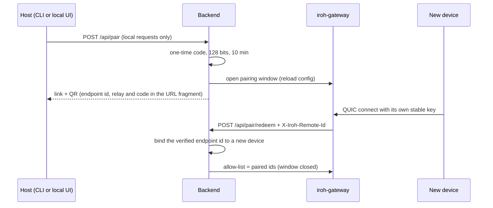

# Security

Hermes UI gives remote control over an agent that can run commands on your machine. Treat a paired
device like a logged-in terminal. This page describes what protects the backend, what crosses the
network, and what is stored where. Architecture details: [architecture.md](architecture.md).

## Threat model

**Assets:** the ability to start and steer Hermes sessions and to answer approval prompts; the content
of chats, transcripts and images; the device secrets that grant that access.

**Trusted:** the host machine and its user account, the Hermes gateway, and devices you paired yourself.

**Not trusted:** the network, iroh relays, tunnel providers, the static host that serves the web UI,
push services, and any device that has not been paired.

**Out of scope:** a compromised host, a compromised paired device, and the security of Hermes Agent
or Paseo themselves.

## Controls

### Loopback only

The backend binds to `127.0.0.1`. The host is not configurable (`server/src/config.mjs`). Remote modes
start a tunnel as a child process that connects from inside; there is no open port.

A request counts as *local* only if it arrives on loopback with a loopback `Host` header and carries
none of `X-Forwarded-For`, `X-Forwarded-Host`, `Cf-Connecting-Ip`, `Tailscale-User-Login` or
`X-Iroh-Remote-Id`. Tunnels also connect from loopback, but they add these headers.

### Local browsers: token and device cookie

- On first start the backend generates `HERMES_UI_TOKEN` (24 random bytes) and appends it to `.env`
  with file mode `0600`.
- `POST /api/login` with the token issues a device cookie `hk_device`: `HttpOnly`, `SameSite=Strict`,
  `Path=/`, `Secure` for remote requests, valid for 90 days.
- The cookie holds a device id and a 32-byte random secret. Only the SHA-256 hash of the secret is
  stored (`data/devices.json`). Comparisons are constant-time.
- Scripts may send the token as `Authorization: Bearer …`. The backend also accepts `?token=` in the
  URL for older clients; avoid it, because URLs end up in logs and history.

### Pairing

- **Only the host can create codes.** `POST /api/pair` returns 403 for any non-local request, so a
  leaked remote session cannot add devices.
- **The code is single-use.** It is stored only as a hash and expires after 10 minutes.
- **The code travels in the URL fragment** (`#…`). Browsers never send the fragment to a web server,
  so the static host that serves the UI does not see it.
- In tunnel modes the link is `<tunnel-url>/pair#<code>` and redeeming it sets the device cookie.

### iroh: allow-list at connection time

- Every client has a stable iroh key. The browser persists it in its storage. The mobile app keeps it
  in the Android Keystore or iOS Keychain through `expo-secure-store`.
- The gateway admits only the endpoint ids in `IROH_ALLOW_CLIENTS`. An unpaired device is refused
  during the connection handshake, even if it knows the token or guesses a pairing code.
- With no paired device and no open pairing window, the gateway refuses every path
  (`IROH_ALLOW_PATHS=/__closed__`). It forwards only `/api`.
- The gateway config also sets a request rate limit (`IROH_RATE_LIMIT=30`, `IROH_RATE_BURST=120`).
- **Second check in the backend.** The gateway puts the endpoint id it verified into
  `X-Iroh-Remote-Id`. The backend trusts that header only in iroh mode and only on loopback
  connections, that is, from its own gateway child. For such requests only the paired identity counts;
  tokens and cookies are ignored.

### Rate limiting

`/api/login` and `/api/pair/redeem` allow 10 failed attempts per client per 10 minutes, then answer
429. The client is keyed by `Cf-Connecting-Ip`, `X-Forwarded-For` or the socket address.

### Device revocation

Removing a device in the remote-access dialog (`DELETE /api/devices/:id`) deletes its record and its
push subscriptions, and rewrites the gateway allow-list. The device is refused at its next connection,
and the backend's per-request check rejects it at once. "Sign out" on a device removes its own record
and subscriptions the same way (the gateway allow-list follows within 30 s). Pairing again later
issues a new device record.

### HTTP hardening

- Static files and `/api/file` responses send `X-Frame-Options: DENY`, `Referrer-Policy: no-referrer`
  and `X-Content-Type-Options: nosniff`.
- `/api/file` responses also send `Content-Security-Policy: default-src 'none'; sandbox`.
- API responses are `Cache-Control: no-store`. JSON request bodies are capped at 60 MB.

## What passes through relays and third parties

| Party | Sees | Does not see |
|---|---|---|
| iroh relay (public n0 relays or your own) | Endpoint ids, IP addresses, timing and size of traffic | Content: QUIC traffic is end-to-end encrypted between device and gateway |
| Direct path (mobile app) | Your network sees UDP between the two IP addresses | Content |
| Static host of the web UI (e.g. GitHub Pages) | Page and asset requests | The pairing fragment, API traffic, data |
| Cloudflare quick tunnel (`cloudflare` mode) | Everything: TLS ends at Cloudflare's edge | – |
| Tailscale (`tailscale-*` modes) | Metadata; TLS or WireGuard ends on your own machine | Content |
| Web push services (Apple, Google, Mozilla) | Delivery metadata; the payload is encrypted for the browser | – |
| FCM (Android app, optional) | Chat title and kind, the deep link and badge count: FCM messages are not end-to-end encrypted | Chat content |

Run your own relay with `IROH_RELAY_URL` to keep metadata off public relays
([self-hosting.md](self-hosting.md#own-iroh-relay)).

## Push payloads

A push carries the chat title, the kind of event as a fixed label ("Approval needed", "Done",
"Error", …), a deep link to the thread or inbox, a tag and the unread count. It never carries
messages, commands or answers. Where notification actions are reliable (not Apple's push service),
Hermes approvals get *Allow* / *Deny* actions. They only open the app with a confirmation dialog; they
never answer by themselves.

## Files and media

The UI shows images from transcripts. The backend serves local files only under these rules
(`server/src/local-files.mjs`):

- **Allowed roots:** Hermes' image cache (`$HERMES_HOME/cache`), `PASEO_HOME`, directories named
  `paseo-attachments-*` directly in the temp directory, and the directories in `HERMES_UI_IMAGE_ROOTS`.
  From these, only image types (png, jpg, gif, webp, avif).
- **Real-path check:** the path is resolved with `realpath` (symlinks and `..`) before the root check.
  Relative paths and NUL bytes are refused.
- **MEDIA attachments:** a file named by `MEDIA:<path>` in a stored assistant reply becomes readable
  individually (images and audio), wherever it lives. Nothing else in that directory does.
- Files over 25 MB, directories and unknown types return 404.
- `/api/media/…` serves only the board's own copies under `data/media/`.

Keep `HERMES_UI_IMAGE_ROOTS` narrow: every image below those directories becomes readable by paired
devices.

## What is stored where

| Location | Contents | Protection |
|---|---|---|
| `.env` | `HERMES_UI_TOKEN` and settings | File mode `0600`; git-ignored |
| `data/devices.json` | Paired devices: name, iroh endpoint id, hash of the cookie secret, timestamps | `0600` |
| `data/iroh/` | Gateway key, gateway access config, gateway log, downloaded binary | Directory `0700`, config `0600` |
| `data/vapid.json`, `data/push.json` | Web Push key pair; push subscriptions and FCM tokens per device | `0600` |
| `data/inbox.json` | Inbox history: chat titles, short excerpts of requests and replies, answers | `0600` |
| `data/board.json`, `data/media/` | Manual columns, drafts, outbox, copies of sent media | – |
| `data/tailscale/` | State of the userspace Tailscale daemon (Tailscale modes) | Directory `0700` |
| Browser | iroh key and remembered endpoint, preferences, the device cookie | Browser storage |
| Mobile app | iroh key and gateway in Keystore / Keychain; cache and media in the app's documents directory | OS app sandbox |

The backend writes nothing to `$HERMES_HOME`. Backups and moving to a new machine:
[secrets-and-state.md](secrets-and-state.md).

## Known limits

- Any process on the host can reach `127.0.0.1:8787`. In iroh mode such a process could send a forged
  `X-Iroh-Remote-Id`. It would need the endpoint id of a paired device, but endpoint ids are public
  keys, not secrets. On a shared multi-user machine, other local users count as trusted.
- An approval answered from a device runs on the host with Hermes' permissions. A stolen, unlocked
  phone is as dangerous as an open terminal: revoke it from the host.
- The public relays are run by a third party. They cannot read content, but they see who talks to
  whom and when.

## Reporting a vulnerability

Please do not open a public issue. Use GitHub's private vulnerability reporting: the repository's
**Security** tab → **Report a vulnerability**. Include the affected version or commit, the steps to
reproduce, and the impact you see. Fixes are released as normal commits and noted in the changelog
once users can update.
